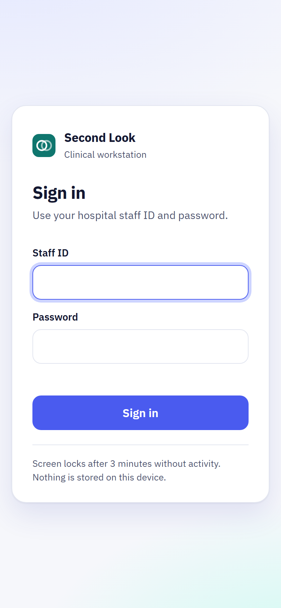
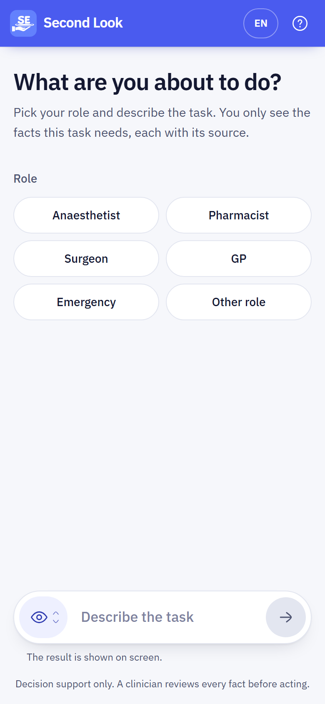
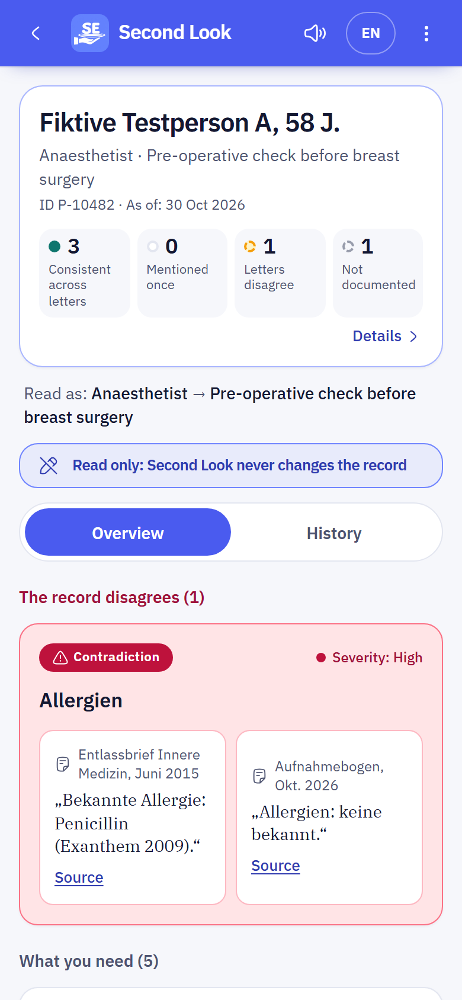
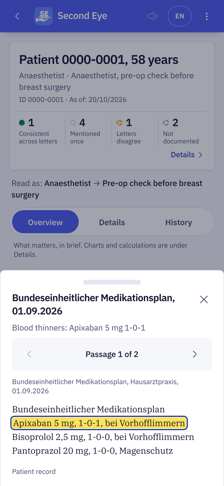
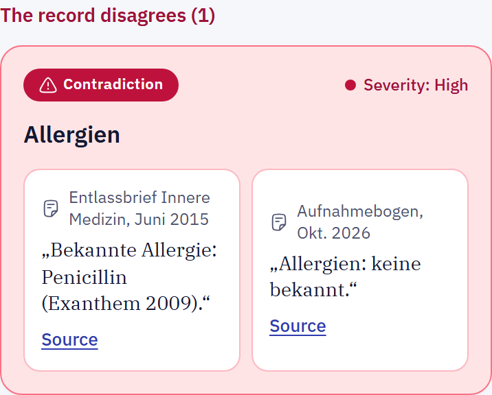
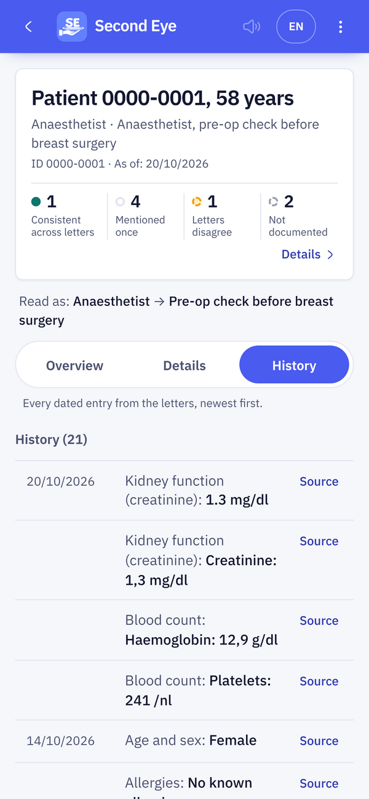
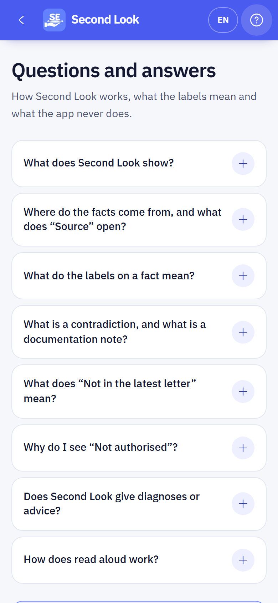
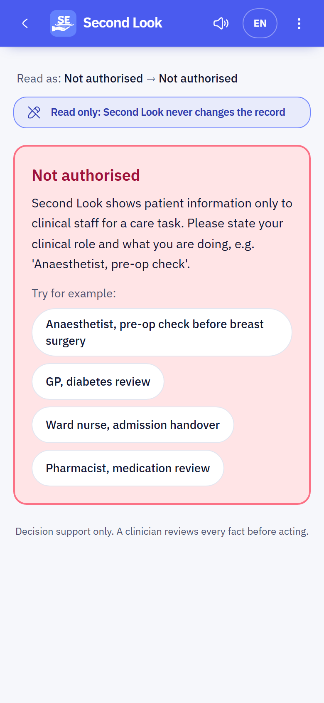
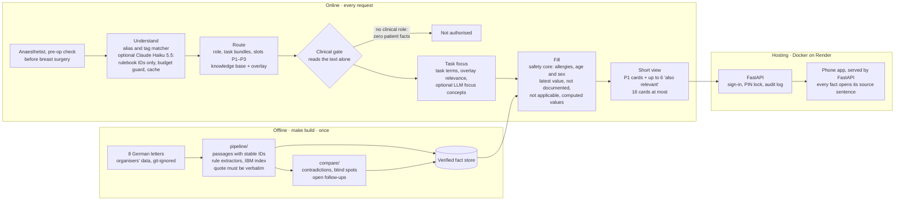

<div align="center">



# Second Look

**Other tools summarise the record. Second Look checks it, for the task in front of you.**

A clinician types one sentence: who they are and what they are about to do.<br>
Second Look answers with one screen: only the facts that task needs, each linked to the exact sentence it came from.

[](docs/CHALLENGE.md)


**[▶ Watch the film with sound](docs/media/second-look.mp4)** · <sub>Animated from the real app running on its invented demo patient. No patient data is shown.</sub>

</div>

---

## The problem

A patient's record is a pile of letters, and each letter copies the last one. Errors travel from letter to letter (a left-sided finding becomes right-sided), and facts quietly fall out of the newest letter. An anaesthetist, a surgeon and an emergency physician each need different facts from the same pile, and none of them has time to read eight letters.

## What Second Look does

Type *"Anaesthetist, pre-operative check before breast surgery"* and get one screen with:

- **The facts that task needs, and nothing else.** Blood thinner and dose, allergies, heart function, each linked to the sentence or table row in the original German letter.
- **What is missing, said out loud.** "Not documented" (with what was searched) or "not applicable" (with its evidence), decided by code, never by a model.
- **Where the record disagrees with itself.** Contradictions between letters with every passage side by side, facts the latest letter dropped, and follow-ups that were never closed.

Switch the doctor and keep the patient: the surgeon and the emergency physician each get a different screen, built for their task. Roles we never prepared for still get a screen instead of an error.

## Screens

<table>
  <tr>
    <td width="23%" align="center"><br><sub>Sign in, then a PIN lock</sub></td>
    <td width="23%" align="center"><br><sub>One sentence: role and task</sub></td>
    <td width="23%" align="center"><br><sub>Only the facts the task needs</sub></td>
    <td width="23%" align="center"><br><sub>Every fact opens its source</sub></td>
  </tr>
  <tr>
    <td width="23%" align="center"><br><sub>Where the letters disagree</sub></td>
    <td width="23%" align="center"><br><sub>Earlier values, each with its source</sub></td>
    <td width="23%" align="center"><br><sub>Help: what the labels mean</sub></td>
    <td width="23%" align="center"><br><sub>No clinical role, no patient data</sub></td>
  </tr>
</table>

Results screens use the invented demo patient; no organiser data is shown.

## Results

Measured on the organisers' five situations ([`docs/SUBMISSION.md`](docs/SUBMISSION.md), reproducible with the commands below).

| Metric | Target | Second Look |
|---|:---:|:---:|
| Correct answers | 15 / 15 | **15 / 15**, in both the short phone view and the long view |
| Traceability | 100 % | **100 %** by construction: every fact cites its passage, 0 invariant violations |
| Invented facts | 0 | **0**: a fact whose quote is not verbatim in its passage never reaches the API |
| Contradictions, net of false alarms | ≥ 5 | **5 real, 0 known false alarms**, plus 3 documentation notes kept apart |
| Slowest screen | < 10 s | **144 ms** at the API, **453 ms** on the phone from submit to rendered facts |

Also: 15 unseen situations (new roles, a German request, a misspelling) all render without errors in ≤ 0.5 s each.

### Evaluation layers

| Layer | What it checks | Status |
|---|---|---|
| Official situations | The organisers' 15 questions on the fact store (`python3 -m eval.run --strict`) and over HTTP (`python3 -m eval.run_api`) | **15 / 15**, 0 invariant violations |
| Synthetic set v1 | 70 situations, 170 questions: German, typos, unseen and non-clinical roles (`python3 -m eval.synthetic.run`) | 170 / 170. Rules were fitted on this set, so it is not a generalisation result ([`docs/TESTING.md`](docs/TESTING.md) §3) |
| Adversarial hold-out v2 | 73 situations written by an independent author who never saw the engine (`python3 -m eval.synthetic.run --file eval/synthetic/holdout_v2.json`) | Work in progress, measured in [`docs/TESTING.md`](docs/TESTING.md) |
| Phone app end to end | 39 Playwright cases against the real backend, including axe accessibility checks (`cd mobile && npm run e2e`) | Run before each merge |

## How it works

Two phases. An offline build reads the eight letters once and freezes a verified fact store. Every request after that only looks things up, so a screen takes milliseconds, not seconds.



| Component | Path | What it does |
|---|---|---|
| Fact store | `pipeline/` | Splits each letter into passages with stable IDs and offsets, extracts typed facts (medication, allergy, measurement, finding, plan), links IBM's extraction as an index only, and rejects any fact whose quote is not verbatim. |
| Compare | `compare/` | Deterministic checks: BMI recomputed from height and weight, event dates, laterality. Counts only passages that cannot all be true; typos and method differences become documentation notes. |
| Routing knowledge base | `rulebook/kb/` | Written by the medical team: 20 roles, 18 task bundles, 63 fact slots with priorities P1–P3, 22 rules and 21 guideline sources. Holds no patient facts. |
| Knowledge base overlay | `rulebook/kb_overlay.json` | 5 more roles (rheumatologist, urologist, psychologist, social worker, nephrologist), extra aliases and tags, task terms and task relevance rules; each new rule is marked `TODO-cite` for the medical team. |
| Query engine | `engine/` | Situation → role and task → needs → answer cards: consistent, conflicting, outdated, not documented, not applicable. Allergies and age/sex are on every clinical screen; the short view adds up to 6 "also relevant" P2 cards and caps a screen at 16 cards. |
| Clinical gate | `engine/clinical.py` | Patient data only for a clinical requester, decided from the text by rules (`rulebook/clinical_roles.json`). Not authorised means zero patient facts. |
| Task focus | `engine/focus.py` | Promotes record facts the task points at into one card after the P1 needs: task terms, overlay relevance, and with the LLM on, its `focus_concepts`. |
| LLM layer | `engine/llm.py`, `engine/llm_budget.py` | Optional Claude Haiku 5.5 reading of the request, with a daily budget and call cap and an in-process cache. |
| Security | `security/`, `backend/app/auth.py` | Sign-in with salted PBKDF2 hashes, PIN lock, idle and background lock, hash-chained audit log. |
| API | `backend/app/` | FastAPI: the `Briefing` schema, documents and passages for the source view, sign-in and PIN lock, and serves the built app. |
| Phone app | `mobile/` | React 19, Vite, Tailwind 4, Motion. Facts with their sources, contradictions, open items, value history and a source viewer that highlights the cited words. English and German. |
| Evaluation | `eval/`, `eval/synthetic/` | Scores the 15 official answers on the fact store and over HTTP, and checks the invariants (quotes verbatim, every number inside its quote). `eval/synthetic/` holds the 70-situation set and the adversarial hold-out. |

## Where AI is used, and where it is not

The core is deterministic, so every screen can be reproduced and checked.

| Step | How | Why |
|---|---|---|
| Extracting facts | Rules, plus IBM's extraction used as an index; every quote is validated in code | Eight short letters: rules are checkable and fast |
| Understanding the request | Alias and tag matcher (English and German, fuzzy). **Optional:** with `SECOND_LOOK_LLM=1`, Claude Haiku 5.5 reads every request and proposes a role and task bundles through structured output limited to the knowledge base's own IDs | Unusual wording and unseen roles. Every pick is checked again in code. It may add one bundle when the rules matched (up to three when they did not) and set the role only when the rules found none or a fuzzy one. On a timeout (4 s), an error or a spent budget the rules answer alone. `engine/llm_budget.py` caps daily spend and calls; repeated requests hit a cache. `/health` shows the layer's state and every briefing records `routing.llm_used` |
| Who may see patient data | Clinical gate, rules only | The model never authorises: the gate reads the request text alone |
| Task focus | Task terms and overlay rules in code. **Optional:** the model returns up to five `focus_concepts` | The model can only pick from this record's own concept labels; code maps them back to existing facts, shown as "AI-highlighted for this task" |
| "Not documented", contradictions, calculations, what to show | Code only | The model never writes patient facts, statuses, verdicts or numbers |

No guideline text is processed by a model. Guidelines in the knowledge base only explain why a fact is on a checklist; they are never shown as patient facts.

## What every screen guarantees

- **Every fact is quoted and linked.** No verbatim quote in a known passage, no fact.
- **Missing is explicit.** A need with no fact says "not documented", decided by code.
- **Computed values show their inputs.** Age, weight change and BMI link every passage they use.
- **Contradictions are tiered.** Only passages that cannot all be true are counted; changes over time and small measurement differences are not flagged.
- **No clinical role, no patient data.** A journalist or a neighbour gets a "not authorised" screen with zero facts.
- **Locked by default.** Sign-in, a PIN after 3 minutes idle, and a tamper-evident audit log that stores the task only as a hash.
- **Read only.** Second Look never changes the record.

## Run it locally

Requirements: Python 3.11+, Node 20+. The organisers' patient data is **not in this repository** (challenge rule); `data/`, `cache/` and `*.zip` are git-ignored.

```bash
# 1. Data: unzip the organisers' data at the repo root -> data/patient-0000-0001/...
pip install -r backend/requirements.txt
make build                                   # fact store + contradictions -> data/build/
make backend                                 # API on http://127.0.0.1:8000
cd mobile && npm ci && npm run dev           # app on http://localhost:5173 (new terminal)
```

Sign in with the demo user in [`security/README.md`](security/README.md) (replace it before any deployment). `VITE_MOCK=1 npm run dev` runs the app on an invented demo patient without a backend.

| Variable | Effect |
|---|---|
| `SECOND_LOOK_LLM=1` + `ANTHROPIC_API_KEY` | Claude proposes role and task IDs for unusual wording (model: `SECOND_LOOK_LLM_MODEL`, default `claude-haiku-5-5`) |
| `SECOND_LOOK_RULEBOOK=legacy` | Use the earlier hand-written role tables instead of the knowledge base |
| `SECOND_LOOK_USERS` | Path to your own users file (salted PBKDF2 hashes) |

Without the app: `python3 -m engine.query "Anaesthetist, pre-operative check before breast surgery" --brief`

### Tests and evaluation

```bash
make test                          # 186 unit tests: engine, knowledge base, clinical gate, LLM layer, compare, eval, security, backend
python3 -m eval.run --strict       # 15 official answers; exits 1 unless 15/15 and 0 invariant violations
python3 -m eval.run_api            # the same over HTTP, with latency
cd mobile && npm run e2e           # 39 Playwright cases against the real backend, including axe accessibility checks
```

Most engine tests need the organisers' data. A further synthetic set of 70 situations and 170 questions (German, typos, unseen and non-clinical roles) is documented in [`docs/TESTING.md`](docs/TESTING.md); the engine was tuned on it, so its score is not quoted as a result.

<details>
<summary><b>Repository layout</b></summary>

```
pipeline/     fact store build (passages, extractors, IBM linker)
compare/      contradictions, blind spots, follow-ups
engine/       understand → route → fill; clinical gate; optional LLM layer (llm.py, llm_budget.py)
rulebook/     routing knowledge base (kb/), overlay, legacy role and task tables
backend/      FastAPI app (app/), sign-in and PIN lock (auth.py), tests
mobile/       the phone app (React 19 + Vite), Playwright e2e
security/     sign-in, PIN lock, audit log (standard library only)
eval/         scorers, answer keys, contradiction gold list, unseen and synthetic situations
cases/        the organisers' five situations and expected answers
video/        code-rendered submission video (Remotion) and its soundtrack
deploy/       container entrypoint; data comes from a secret at start-up, never from git
docs/         challenge, plan, contracts, integration, decisions, testing, submission
```

</details>

## Limitations

- **One record.** Built and measured on the challenge's single patient (eight letters). New patients need the offline build first.
- **Unfamiliar requests are the weak spot.** On an adversarial holdout written independently of the engine (73 situations, [`holdout_v2_run1.md`](eval/synthetic/results/holdout_v2_run1.md), rules only, LLM layer not run), Second Look answers 78 of 227 questions (34 %). Non-clinical requests are refused 9 of 9 times; unusual roles and requests in other languages fail most often.
- **The knowledge base is a draft.** Some guideline citations are still placeholders (`TODO-cite`) and a full clinician review is pending.
- **The clinical gate is a demo safeguard.** It reads the role from the request; a hospital deployment would take the role from the sign-in.
- **The LLM layer is off by default.** When it is on, the record's diagnosis labels are sent to Anthropic to choose the task.
- **No licence file yet.**

## Team

Built at the AIM Austria hackathon by a team of developers and clinicians: [Omar](https://github.com/omarjku) (backend: fact store, compare, engine, API), Zoha (phone app), [Waji](https://github.com/syedwajiulhassan715-rgb) (product plan, API shell, app integration, end-to-end tests), and Mani with the medical team (routing knowledge base).

## Data

The patient record is synthetic data provided by IBM Austria for the hackathon and is not redistributed here. Guidelines are referenced by title and link only; no guideline text is reproduced or processed by a model.

<sub>The film at the top is drawn frame by frame in code and scored with a procedurally generated soundtrack: <a href="https://github.com/omarjku/omarjku/tree/main/motion">source</a>.</sub>
