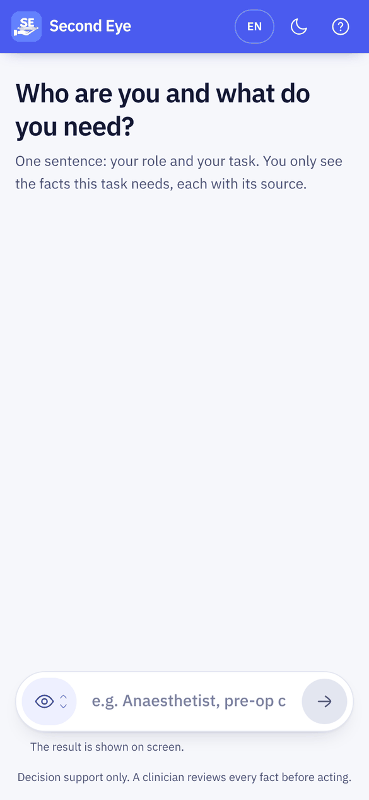
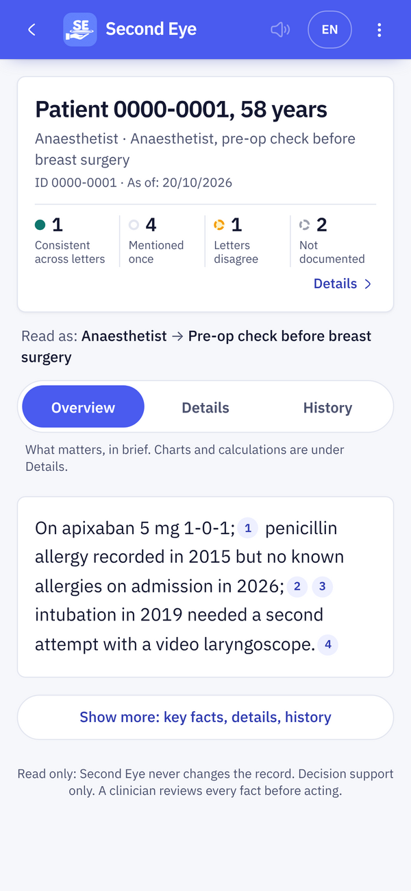
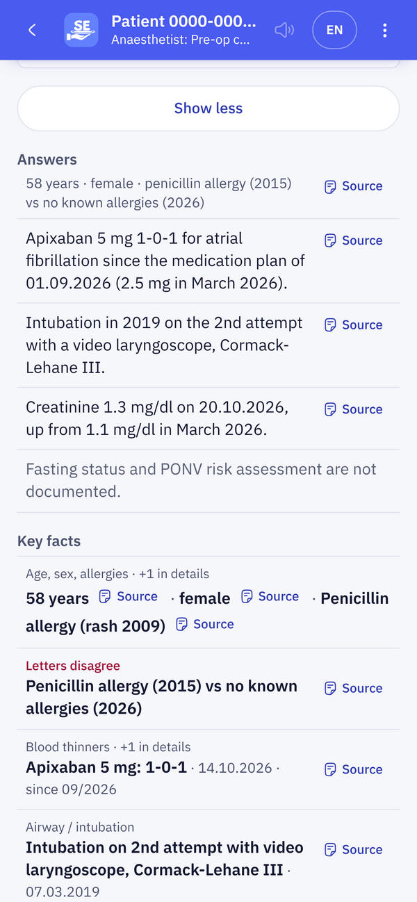
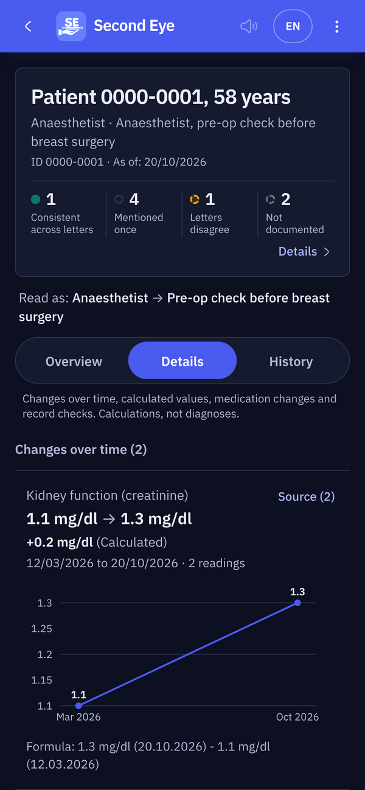
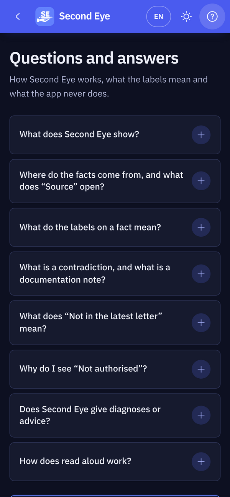
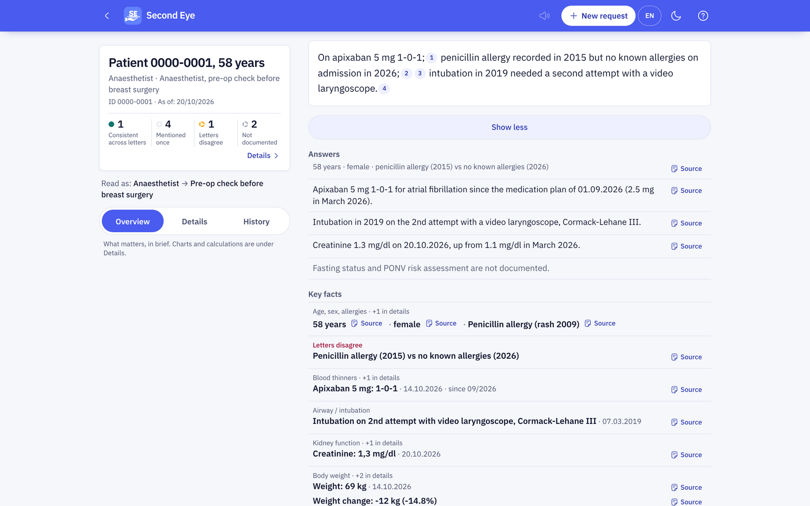
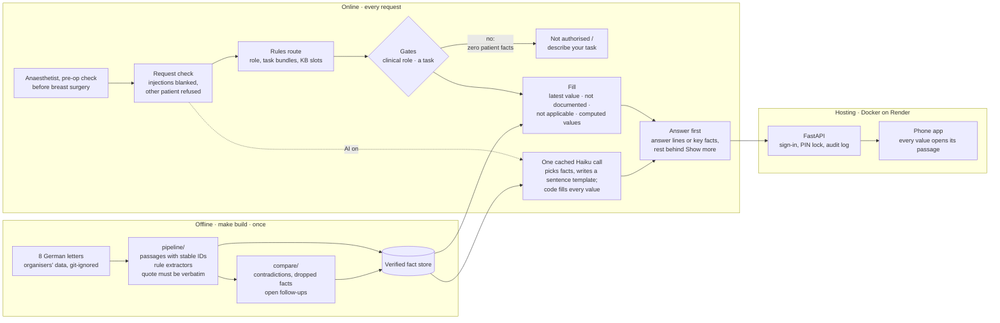

<div align="center">


# Second Eye

**Other tools summarise the record. Second Eye checks it, for the task in front of you.**

A clinician types one sentence: who they are and what they need.<br>
Second Eye answers first, in a sentence or two. Every value comes from the letters and opens the exact passage it came from.

**[Open the live app](https://second-look-1433.onrender.com)** · <sub>No sign-in needed. Runs on a synthetic patient record.</sub>

[](docs/CHALLENGE.md)


**[▶ Watch the film with sound](docs/media/second-eye.mp4)** · <sub>Every screen in it is the real app running on an invented patient. No patient data is shown.</sub>

</div>

---

## About

Second Eye is a task-based reader for clinical records, built at the AIM Austria hackathon (Track 1, clinical documentation). It reads a patient's German letters once, keeps only facts it can quote word for word, and then answers each clinician's task from that verified store. It never writes to the record, and code, not a model, decides what is missing and where the letters disagree.

**Live app:** <https://second-look-1433.onrender.com>

## The problem

A patient's record is a pile of letters, and each letter copies the last one. Errors travel from letter to letter (a left-sided finding becomes right-sided), and facts quietly fall out of the newest letter. An anaesthetist, a surgeon and an emergency physician each need different facts from the same pile, and none of them has time to read eight letters.

## What Second Eye does

Type *"Anaesthetist, pre-op check before breast surgery"* and the screen opens with:

- **The answer, first.** One or two sentences with numbered sources [1] [2]. Tap a number and the German letter opens with the passage highlighted.
- **What is missing, said out loud.** "Not documented", or for a specific question "Nothing found" with the words that were searched, decided by code, never by a model.
- **Where the record disagrees with itself.** Contradictions between letters with both passages side by side, facts the latest letter dropped, follow-ups that were never closed.

Everything else is one tap away: **Show more** for key facts and the full fact list, **Details** for trends, medication changes and calculated values, **History** for every dated entry. Ask a specific question ("did she ever fall?") and it is answered first. The app runs in English or German, light or dark, and can read the answer aloud.

## Screens

<table>
  <tr>
    <td width="25%" align="center"><br><sub>One sentence, as typed</sub></td>
    <td width="25%" align="center"><br><sub>The answer first, with sources</sub></td>
    <td width="25%" align="center"><br><sub>Show more: key facts and conflicts</sub></td>
    <td width="25%" align="center"><br><sub>Every value opens its passage</sub></td>
  </tr>
  <tr>
    <td width="25%" align="center"><br><sub>Details: trends and calculations</sub></td>
    <td width="25%" align="center"><br><sub>History: every dated entry</sub></td>
    <td width="25%" align="center"><br><sub>Help: what the labels mean</sub></td>
    <td width="25%" align="center"><br><sub>No clinical role, no data (rules path)</sub></td>
  </tr>
</table>



<sub>The real app, fed a set of invented letters for an invented patient; no organiser data is shown.</sub>

## Results

Measured on the organisers' five situations and 15 questions ([`docs/SUBMISSION.md`](docs/SUBMISSION.md), [`docs/DECISIONS.md`](docs/DECISIONS.md)); reproducible with the commands below.

| Metric | Target | Second Eye |
|---|:---:|:---:|
| Correct answers | 15 / 15 | **15 / 15**, also inside the key facts and the answer lines |
| Traceability | 100 % | **100 %** by construction: every fact cites its passage, 0 invariant violations |
| Invented facts | 0 | **0**: a fact whose quote is not verbatim in its passage never reaches the API, and model-written sentences get every value substituted by code |
| Contradictions, net of false alarms | ≥ 5 | **5 real, 0 known false alarms**, plus 3 documentation notes kept apart |
| Slowest screen | < 10 s | rules path **144 ms** at the API, **453 ms** on the phone (measured 30 Oct, before the answer-first screen); with the AI answer a hard **4 s** deadline |

### Beyond the official questions

| Test | What it checks | Result (rules only, no AI) |
|---|---|---|
| Paraphrases ([`eval/paraphrase`](eval/paraphrase)) | 165 wordings: each official question asked 5 ways (terse, long, as a question, with a typo, German-English mix) plus 30 common questions 3 ways | **156 / 165**, official 74 / 75 |
| Adversarial hold-out ([`eval/synthetic`](eval/synthetic)) | 73 situations, 234 questions, written by a team member who never saw the engine: unusual roles, other languages, injections, non-clinical requests | **136 / 234** (58 %) after the latest engine fix; the first run scored 78 / 227 |
| Red team ([`eval/redteam`](eval/redteam)) | 604 requests: 383 that must get no data (neighbours, journalists, injections, other patients) and 221 that must | **10 of 383** leak, **5 of 221** wrongly blocked |
| Synthetic set v1 | 70 situations, 170 questions | 170 / 170, but the rules were fitted on it, so it is a regression check, not a result |

## How it works

An offline build reads the eight letters once and freezes a verified fact store. Every request after that only looks things up, so the rules path answers in milliseconds.



| Component | Path | What it does |
|---|---|---|
| Fact store | `pipeline/` | Splits each letter into passages with stable IDs and offsets, extracts typed facts (medication, allergy, measurement, finding, plan), links IBM's extraction as an index only, and rejects any fact whose quote is not verbatim. |
| Compare | `compare/` | Deterministic checks: BMI recomputed from height and weight, event dates, laterality. Counts only passages that cannot all be true; typos and method differences become documentation notes. |
| Routing knowledge base | `rulebook/kb/`, `rulebook/kb_overlay.json` | Written by the medical team: 20 roles, 18 task bundles, 63 fact slots with priorities P1–P3, 22 rules, 21 guideline sources. The overlay adds 21 roles and 55 named topics, each marked `TODO-cite` for review. No patient facts. |
| Request and gates | `engine/request.py`, `clinical.py`, `intent.py`, `llm_gate.py` | Blanks injected instructions and refuses requests about another patient. Patient data only for a clinical requester with a task; greetings and role-only requests get none. The model can narrow these decisions, never widen them. |
| Answers | `engine/ask.py`, `keyfacts.py`, `answers.py` | Specific questions answered first, or "Nothing found" with the words searched. Up to 8 key-fact lines, or up to 4 answer lines whose every word is checked against an allowlist built from that line's own facts. |
| AI answer | `engine/screen_v2.py`, `onecall.py`, `evidence.py`, `cited.py` | With the AI on: one cached Haiku call picks the facts the question needs and writes a sentence template; code substitutes every name, value, dose, schedule, date and side, checks the glue words, appends any required answer the model left out, and falls back to a compact template on any failure. |
| API | `backend/app/` | FastAPI: the `Briefing` schema, documents and passages for the source viewer, sign-in and PIN lock, an optional start-up self-test (`EVAL_ON_START`), and it serves the built app. |
| Phone app | `mobile/` | React 19, Vite, Tailwind 4, Motion. Answer first with numbered sources, Show more, Overview / Details / History, a source viewer that highlights the cited words, English and German, dark mode, read aloud. |
| Evaluation | `eval/` | Official answers on the fact store and over HTTP, invariants (quotes verbatim, every number inside its quote), key facts, answer lines, v2 answers, paraphrases, hold-out and red team. |

## Where AI is used, and where it is not

The core is deterministic. The AI layer is **off by default** and needs `SECOND_LOOK_LLM=1` and an `ANTHROPIC_API_KEY`. The model is Claude Haiku 5.5.

| Step | How | Guardrails |
|---|---|---|
| Extracting facts | Rules, with IBM's extraction as an index; every quote validated in code | No model |
| Understanding the request | Rules always. With the AI on, Haiku also reads the request in parallel | Rules path: the model may refuse a request or add one task bundle; it never sets the role or opens the record. 2.5 s deadline, then the rules answer alone |
| Writing the answer (the default when the AI is on) | One Haiku call, run in parallel with the rules, sees the request and the fact store and returns the fact IDs it needs plus a sentence **template** with placeholders such as `{F0247.dose}` | Code fills every value from the verified facts and allows only allowlisted glue words, at most 2 sentences and 300 characters. A task's required answers are added by code if the model left them out, and a "not documented" topic is shown only if no fact mentions it. A failure, a timeout or the hard 4 s deadline gives a compact template instead |
| Answer lines (rules path) | The rules pick the facts; Haiku may phrase them | Every token must come from that line's facts or a fixed connector list; units, value-date pairs, schedules and sides are checked; otherwise a template |
| "Not documented", contradictions, calculations, who may see data | Code only | The model never decides any of these |

A budget guard caps spend at €4 and 3,000 calls a day by default (`/health` shows usage), and repeated requests hit a cache. **What is sent to Anthropic when the AI is on:** the request text and, in a prompt-cached block reused across requests, every fact in the store as one compact line (date, status, label with value, dose and schedule); on the rules path also the record's concept labels and the facts behind each answer line. No guideline text is sent to a model.

## What every screen guarantees

- **Every value comes from the letters.** No verbatim quote in a known passage, no fact; a model-written sentence has its values substituted by code.
- **Every fact is linked.** Each number opens the passage it came from.
- **Missing is explicit.** A need with no fact says "not documented", decided by code.
- **Computed values show their inputs.** Age, weight change and BMI link every passage they use.
- **Contradictions are tiered.** Only passages that cannot all be true are counted; changes over time and small measurement differences are not flagged.
- **Read only.** Second Eye never changes the record.

## Run it locally

Requirements: Python 3.11+, Node 20+. The organisers' patient data is **not in this repository** (challenge rule); `data/`, `cache/` and `*.zip` are git-ignored.

```bash
# 1. Data: unzip the organisers' data at the repo root -> data/patient-0000-0001/...
pip install -r backend/requirements.txt
make build                                   # fact store + contradictions -> data/build/
make backend                                 # API on http://127.0.0.1:8000
cd mobile && npm ci && npm run dev           # app on http://localhost:5173 (new terminal)
```

Sign-in and the PIN lock are on by default; the demo user is in [`security/README.md`](security/README.md) (replace it before any deployment). `VITE_MOCK=1 npm run dev` runs the app on an invented demo patient without a backend.

Environment variables keep the project's earlier internal prefix `SECOND_LOOK_`.

| Variable | Effect |
|---|---|
| `SECOND_LOOK_LLM=1` + `ANTHROPIC_API_KEY` | Turns the AI layer on (model: `SECOND_LOOK_LLM_MODEL`, default `claude-haiku-5-5`) |
| `SECOND_LOOK_ROUTER=v1` / `v2` | Force the rules path or the AI answer (default: the AI answer when the AI layer is on) |
| `SECOND_LOOK_ANSWERS_LLM=0` | Keep the AI for understanding only; answers use templates |
| `SECOND_LOOK_LLM_BUDGET_EUR`, `SECOND_LOOK_LLM_MAX_CALLS_PER_DAY` | Daily spend and call caps (defaults 4.0 and 3000) |
| `SECOND_LOOK_AUTH=0` | Turns sign-in and the PIN lock off (demo only) |
| `SECOND_LOOK_USERS` | Path to your own users file (salted PBKDF2 hashes) |
| `EVAL_ON_START=1` / `probe` | Run the self-test at start-up and print `EVAL:` lines to the logs |

Without the app: `python3 -m engine.query "Anaesthetist, pre-operative check before breast surgery" --brief`

### Tests and evaluation

```bash
make test                          # 351 tests: engine, gates, answers, v2, knowledge base, compare, eval, security, backend
python3 -m eval.run --strict       # 15 official answers; exits 1 unless 15/15 and 0 invariant violations
python3 -m eval.run_api            # the same over HTTP, with latency
python3 -m eval.paraphrase.run     # 165 paraphrased questions
cd mobile && npm run e2e           # 47 Playwright cases against the real backend, incl. axe accessibility checks (+5 with E2E_V2=1)
```

Most engine tests need the organisers' data. Test layers and every run are documented in [`docs/TESTING.md`](docs/TESTING.md).

<details>
<summary><b>Repository layout</b></summary>

```
pipeline/     fact store build (passages, extractors, IBM linker)
compare/      contradictions, dropped facts, follow-ups
engine/       request check, gates, route, fill, questions, key facts, answer lines, AI answer (onecall.py)
rulebook/     routing knowledge base (kb/), overlay, question lexicon, clinical roles
backend/      FastAPI app (app/), sign-in and PIN lock (auth.py), tests
mobile/       the phone app (React 19 + Vite), Playwright e2e
security/     sign-in, PIN lock, audit log (standard library only)
eval/         scorers, answer keys, synthetic, hold-out, paraphrase and red-team sets
cases/        the organisers' five situations and expected answers
deploy/       container entrypoint; data comes from a secret at start-up, never from git
docs/         challenge, plan, decisions, milestones, testing, submission
```

</details>

## Limitations

- **One record.** Built and measured on the challenge's single patient (eight letters). New patients need the offline build first.
- **The AI answer does not check who is asking.** With the AI layer on, it refuses empty, greeting, spam and injection-only requests and other patients, but answers a clinical question from anyone. The clinical-role gate applies on the rules path (`SECOND_LOOK_ROUTER=v1`). In a hospital the role would come from the sign-in.
- **Unfamiliar requests are the weak spot.** The independent hold-out is at 58 % without the AI; unusual roles and requests in other languages fail most often.
- **The knowledge base is a draft.** Guideline citations marked `TODO-cite` and a full clinician review are pending.
- **Latency was last measured before the answer-first screen.** The AI answer has a hard 4 s deadline; live timings go to the host logs, not to git.
- **No licence file yet.**

## Team

Built at the AIM Austria hackathon by a team of developers and clinicians: [Omar](https://github.com/omarjku) (fact store, compare, engine, gates, AI layer, deployment), Zoha (phone app), [Waji](https://github.com/syedwajiulhassan715-rgb) (product plan, questions, key facts, topics, paraphrase eval, end-to-end tests), and Mani with the medical team (routing knowledge base).

## Data

The patient record is synthetic data provided by IBM Austria for the hackathon and is not redistributed here. Guidelines are referenced by title and link only; no guideline text is reproduced or processed by a model.

<sub>The film at the top is drawn frame by frame in code and scored with a procedurally generated soundtrack: <a href="https://github.com/omarjku/omarjku/tree/main/motion">source</a>.</sub>
