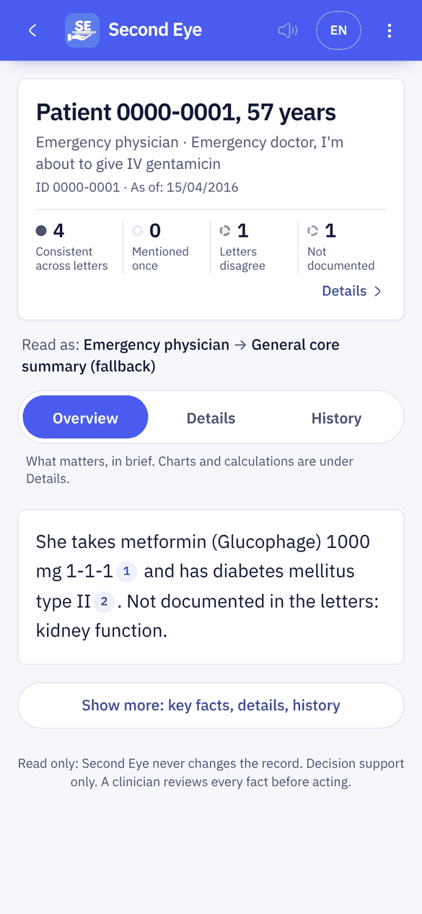
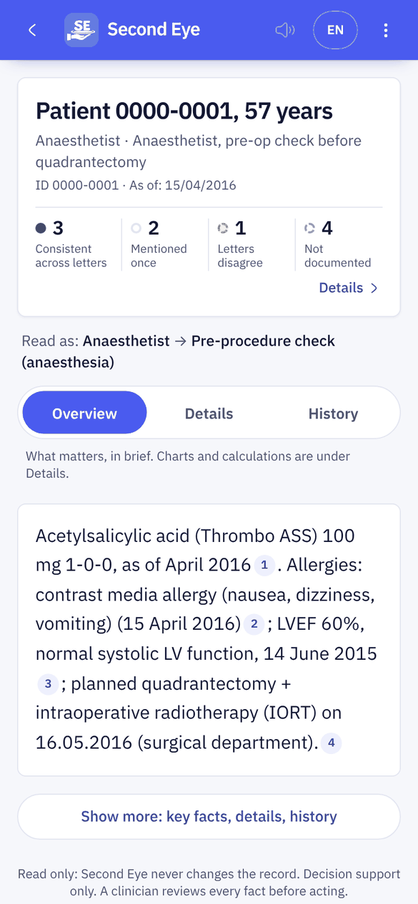
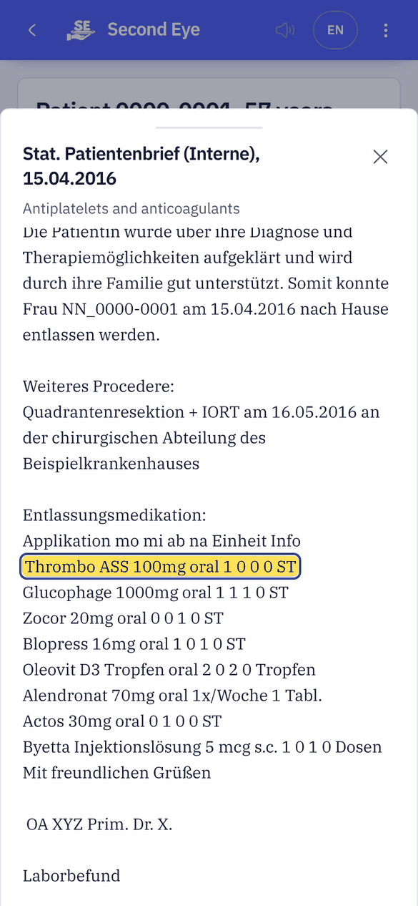
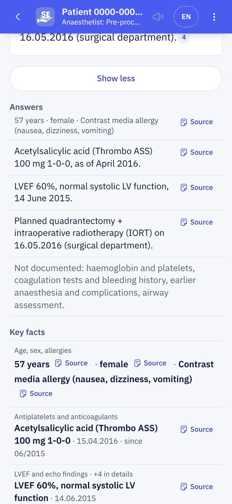
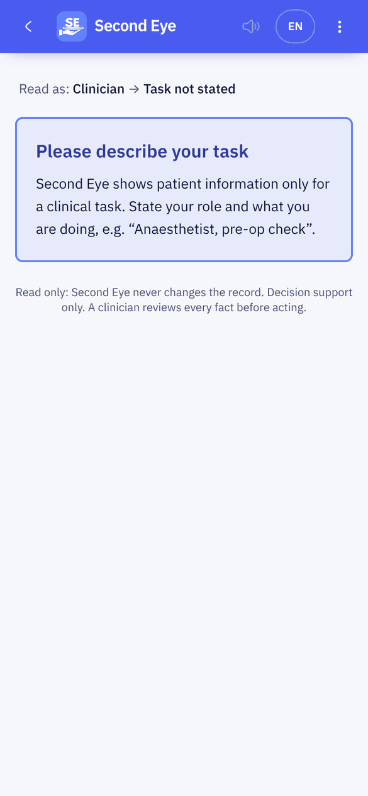
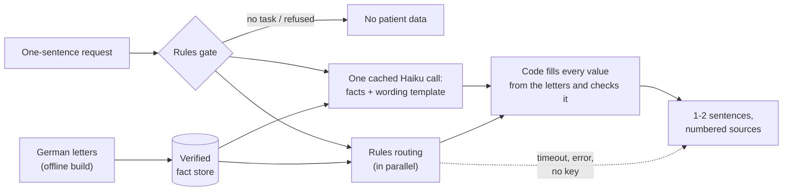

<div align="center">


# Second Eye

**Other tools summarise the record. Second Eye checks it, for the task in front of you.**

A clinician types one sentence: who they are and what they need.<br>
Second Eye answers first, in a sentence or two. Every value comes from the letters and opens the exact passage it came from.

**[Open the live app](https://second-look-1433.onrender.com)** · <sub>No sign-in needed. Runs on a synthetic patient record.</sub>

[](docs/CHALLENGE.md)


**[▶ Watch the film with sound](docs/media/second-eye.mp4)** · <sub>Every screen in it is the real app running on an invented patient. No patient data is shown.</sub>

</div>

---

## About

Second Eye is a task-based reader for clinical records, built at the AIM Austria hackathon (Track 1, clinical documentation). It reads a patient's German letters once and keeps only facts it can quote word for word. A clinician then types one sentence, such as *"Anaesthetist, pre-op check before quadrantectomy"*, and gets a one- or two-sentence answer with numbered source chips; a tap opens the original letter with the passage highlighted. It never writes to the record, and code, not a model, decides what is missing and where the letters disagree.

**Live app:** <https://second-look-1433.onrender.com>

## The problem

A patient's record is a pile of letters, and each letter copies the last one. Errors travel from letter to letter (a left-sided finding becomes right-sided), and facts quietly fall out of the newest letter. An anaesthetist, a surgeon and an emergency physician each need different facts from the same pile, and none of them has time to read eight letters.

## What you see

- **The answer, first.** One or two sentences with numbered sources [1] [2]. Tap a number and the letter opens with the passage highlighted.
- **"Not documented" when something is missing.** Decided by code, never by a model, and shown in the answer itself ("Not documented in the letters: kidney function").
- **Contradictions are flagged** next to the value they affect, with both passages one tap away.
- **"Show more"** opens the key facts, details (trends, medication changes, calculated values) and the history of dated entries.
- **No task, no data.** A greeting such as "hi" gets only a prompt to describe the task, with no patient information.

English or German, light or dark, and the answer can be read aloud. Without an API key the app still works: the rules path produces the answers from templates.

## Screens

Phone, 390 × 844. Captured from the running app with no API key (the template answer path) on the organisers' synthetic record; the full letters are not in this repository.

<table>
  <tr>
    <td width="33%" align="center"><br><sub>Start: one text box</sub></td>
    <td width="33%" align="center"><br><sub>"Emergency doctor, about to give IV gentamicin"</sub></td>
    <td width="33%" align="center"><br><sub>"Anaesthetist, pre-op check before quadrantectomy"</sub></td>
  </tr>
  <tr>
    <td width="33%" align="center"><br><sub>A source chip opens the letter, passage highlighted</sub></td>
    <td width="33%" align="center"><br><sub>"Show more": answers, key facts, details</sub></td>
    <td width="33%" align="center"><br><sub>"hi": no task, no patient data</sub></td>
  </tr>
</table>

<sub>The film at the top was made earlier on an invented patient; it shows the same answer-first flow, but its answer card predates the current one-sentence answer with source chips.</sub>

## Results

Measured on the organisers' five situations and 15 questions and on our own test sets. Sources: [`docs/TESTING.md`](docs/TESTING.md), [`docs/SUBMISSION.md`](docs/SUBMISSION.md), [`docs/DECISIONS.md`](docs/DECISIONS.md). Reproducible with the commands below.

| Metric | Result |
|---|---|
| Official questions | **15 / 15** correct |
| Facts traced to the letters | **254 / 254**: each fact's quote is verbatim in its passage |
| Invented facts | **0**: every value in an answer is filled in by code from the letters |
| Contradictions found | **5** real, 0 known false alarms (plus 3 documentation notes kept apart) |
| Live speed, with the AI call | median about **2 to 3 s** per answer (hard 4 s deadline, then the rules answer) |
| Cost with the AI call | about **EUR 0.0002** per answer (Claude Haiku, cached prompt) |
| Red-team inputs | **604** requests (383 that must get no data, 221 that must get data); rules only: 10 of 383 leak, 5 of 221 wrongly blocked |
| Held-out questions | **234** questions in 73 situations, written by a team member who never saw the engine; rules only: 136 / 234 |

The other test sets (165 paraphrased questions, 156 / 165 on rules only; a 170-question set the rules were fitted on, used as a regression check) are listed in [`docs/TESTING.md`](docs/TESTING.md).

## How it works

An offline build reads the eight letters once and freezes a verified fact store. Each request then goes through these steps:

1. **Rules gate (0 ms).** Empty input, greetings and injected instructions get no data; a request about another patient is refused.
2. **One cached Claude Haiku call.** It reads the request against the whole fact store (a cached prompt). It understands the question, picks the facts that answer it, and writes the wording as a template with placeholders such as `{F0247.dose}`.
3. **In parallel, the rules routing.** The knowledge base picks the role, task and fact slots, and fills the cards behind "Show more".
4. **Code fills and checks.** Every name, dose, date and side is copied from the letters; only allowed connector words may remain, and every required fact must be placed. A failure, a timeout or an error gives a compact template from the rules instead.
5. **The answer.** One or two sentences with numbered source chips, contradictions flagged, "Not documented" where the letters are silent.

Without `ANTHROPIC_API_KEY` steps 2 and 4 are skipped and the rules path answers alone.



### Components

| Component | Path | What it does |
|---|---|---|
| Fact store | `pipeline/` | Splits each letter into passages with stable IDs and offsets, extracts typed facts (medication, allergy, measurement, finding, plan), links IBM's extraction as an index only, and rejects any fact whose quote is not verbatim. |
| Compare | `compare/` | Deterministic checks: BMI recomputed from height and weight, event dates, laterality. Counts only passages that cannot all be true; typos and method differences become documentation notes. |
| Routing knowledge base | `rulebook/kb/`, `rulebook/kb_overlay.json` | Written by the medical team: 20 roles, 18 task bundles, 63 fact slots with priorities P1–P3, 22 rules, 21 guideline sources. The overlay adds 21 roles and 55 named topics, each marked `TODO-cite` for review. No patient facts. |
| Request and gates | `engine/request.py`, `clinical.py`, `intent.py`, `llm_gate.py` | Blanks injected instructions and refuses requests about another patient. Patient data only for a clinical requester with a task; greetings and role-only requests get none. The model can narrow these decisions, never widen them. |
| Answers | `engine/ask.py`, `keyfacts.py`, `answers.py` | Specific questions answered first, or "Nothing found" with the words searched. Up to 8 key-fact lines, or up to 4 answer lines whose every word is checked against an allowlist built from that line's own facts. |
| One-call answer | `engine/onecall.py`, `screen_v2.py`, `evidence.py`, `cited.py` | With the AI on: one cached Haiku call picks the facts and writes a sentence template; code substitutes every name, value, dose, schedule, date and side, checks the glue words and that every required fact is placed, and falls back to a compact template on any failure. |
| API | `backend/app/` | FastAPI: the `Briefing` schema, documents and passages for the source viewer, sign-in and PIN lock, an optional start-up self-test (`EVAL_ON_START`), and it serves the built app. |
| Phone app | `mobile/` | React 19, Vite, Tailwind 4, Motion. Answer first with numbered sources, Show more, Overview / Details / History, a source viewer that highlights the cited words, English and German, dark mode, read aloud. |
| Evaluation | `eval/` | Official answers on the fact store and over HTTP, invariants (quotes verbatim, every number inside its quote), key facts, answer lines, v2 answers, paraphrases, hold-out and red team. |

## Where AI is used, and where it is not

The core is deterministic. The AI layer is **off by default** and needs `SECOND_LOOK_LLM=1` and an `ANTHROPIC_API_KEY`. The model is Claude Haiku 5.5, called once per request.

| Step | How | Guardrails |
|---|---|---|
| Extracting facts | Rules, with IBM's extraction as an index; every quote validated in code | No model |
| Gate | Rules, 0 ms: empty input, greetings, injections, another patient | No model |
| Understanding the question and writing the answer (the default when the AI is on) | One cached Haiku call over the whole fact store returns the fact IDs, "not documented" topics and a sentence **template** with placeholders such as `{F3.dose}` | Code fills every value from the verified facts and checks that only allowlisted glue words remain, that every required fact is placed and that there are at most 2 sentences. Any failure, a timeout (3.5 s for the call, 4 s for the request) or an error gives a compact template instead |
| Answer lines (rules path) | The rules pick the facts; Haiku may phrase them | Every token must come from that line's facts or a fixed connector list; units, value-date pairs, schedules and sides are checked; otherwise a template |
| "Not documented", contradictions, calculations, who may see data | Code only | The model never decides any of these |

A budget guard caps spend at €4 and 3,000 calls a day by default (`/health` shows usage), and repeated requests hit a cache. **What is sent to Anthropic when the AI is on:** the request text and the compact fact store (fact IDs, labels and values, not the letters themselves). No guideline text is sent to a model.

## What every screen guarantees

- **Every value comes from the letters.** No verbatim quote in a known passage, no fact; a model-written sentence has its values substituted by code.
- **Every fact is linked.** Each number opens the passage it came from.
- **Missing is explicit.** A need with no fact says "not documented", decided by code.
- **Computed values show their inputs.** Age, weight change and BMI link every passage they use.
- **Contradictions are tiered.** Only passages that cannot all be true are counted; changes over time and small measurement differences are not flagged.
- **Read only.** Second Eye never changes the record.

## Run it locally

Requirements: Python 3.11+, Node 20+. The organisers' patient data is **not in this repository** (challenge rule); `data/`, `cache/` and `*.zip` are git-ignored.

```bash
# 1. Data: unzip the organisers' data at the repo root -> data/patient-0000-0001/...
pip install -r backend/requirements.txt
make build                                   # fact store + contradictions -> data/build/
make backend                                 # API on http://127.0.0.1:8000
cd mobile && npm ci && npm run dev           # app on http://localhost:5173 (new terminal)
```

To serve the built app from the backend, as the Docker image does (`Dockerfile`, `deploy/start.sh`):

```bash
cd mobile && npm ci && npm run build && cd ..
SECOND_LOOK_AUTH=0 STATIC_DIR=$PWD/mobile/dist python3 -m uvicorn --app-dir backend app.main:app --port 8000
```

Sign-in and the PIN lock are on by default; the demo user is in [`security/README.md`](security/README.md) (replace it before any deployment). `VITE_MOCK=1 npm run dev` runs the app on an invented demo patient without a backend.

Environment variables keep the project's earlier internal prefix `SECOND_LOOK_`.

| Variable | Effect |
|---|---|
| `SECOND_LOOK_LLM=1` + `ANTHROPIC_API_KEY` | Turns the AI layer on (model: `SECOND_LOOK_LLM_MODEL`, default `claude-haiku-5-5`) |
| `SECOND_LOOK_ROUTER=v1` / `v2` | Force the rules path or the one-call answer (default: one-call when the AI layer is on). `v2` without a key gives the template answer path |
| `SECOND_LOOK_LLM_BUDGET_EUR`, `SECOND_LOOK_LLM_MAX_CALLS_PER_DAY` | Daily spend and call caps (defaults 4.0 and 3000) |
| `SECOND_LOOK_AUTH=0` | Turns sign-in and the PIN lock off (demo only) |
| `SECOND_LOOK_USERS` | Path to your own users file (salted PBKDF2 hashes) |
| `EVAL_ON_START=1` / `probe` | Run the self-test at start-up and print `EVAL:` lines to the logs |

Without the app: `python3 -m engine.query "Anaesthetist, pre-operative check before breast surgery" --brief`

### Tests and evaluation

```bash
make test                          # 357 tests (302 engine, 55 backend): gates, answers, one-call answer, knowledge base, compare, eval, security, backend
python3 -m eval.run --strict       # 15 official answers; exits 1 unless 15/15 and 0 invariant violations
python3 -m eval.run_api            # the same over HTTP, with latency
python3 -m eval.paraphrase.run     # 165 paraphrased questions
cd mobile && npm run e2e           # 47 Playwright cases against the real backend, incl. axe accessibility checks (+5 with E2E_V2=1)
```

Most engine tests need the organisers' data. Test layers and every run are documented in [`docs/TESTING.md`](docs/TESTING.md).

<details>
<summary><b>Repository layout</b></summary>

```
pipeline/     fact store build (passages, extractors, IBM linker)
compare/      contradictions, dropped facts, follow-ups
engine/       request check, gates, route, fill, questions, key facts, answer lines, v2 answer, AI layer
rulebook/     routing knowledge base (kb/), overlay, question lexicon, clinical roles
backend/      FastAPI app (app/), sign-in and PIN lock (auth.py), tests
mobile/       the phone app (React 19 + Vite), Playwright e2e
security/     sign-in, PIN lock, audit log (standard library only)
eval/         scorers, answer keys, synthetic, hold-out, paraphrase and red-team sets
cases/        the organisers' five situations and expected answers
deploy/       container entrypoint; data comes from a secret at start-up, never from git
docs/         challenge, plan, decisions, milestones, testing, submission
```

</details>

## What does not work yet

- **Lab tables.** Values in tabular lab reports are not extracted well.
- **Some letter formats.** Built on one patient's eight letters in one layout; other layouts, scans and new patients need extractor work and the offline build.
- **A few attack phrasings.** The red team still finds 10 of 383 requests that should get no data, and 5 of 221 that are wrongly blocked (rules only).
- **Unfamiliar requests.** On the held-out set the rules alone reach 136 / 234; unusual roles and other languages fail most often.
- **The AI answer does not check who is asking.** It refuses empty, greeting, spam, injection-only and other-patient requests, but answers a clinical question from anyone. The clinical-role gate applies on the rules path (`SECOND_LOOK_ROUTER=v1`). In a hospital the role would come from the sign-in.
- **The knowledge base is a draft.** Guideline citations marked `TODO-cite` and a full clinician review are pending.
- **No licence file yet.**

## Team

Built at the AIM Austria hackathon by a team of developers and clinicians: [Omar](https://github.com/omarjku) (fact store, compare, engine, gates, AI layer, deployment), Zoha (phone app), [Waji](https://github.com/syedwajiulhassan715-rgb) (product plan, questions, key facts, topics, paraphrase eval, end-to-end tests), and Mani with the medical team (routing knowledge base).

## Data rule

The patient record is synthetic data provided by IBM Austria for the hackathon. The organisers' data is never committed: `data/`, `cache/` and `*.zip` are git-ignored, and the deployed app unpacks it from a secret at start-up. The screenshots show only short excerpts of it. Guidelines are referenced by title and link only; no guideline text is reproduced or processed by a model.

<sub>The film at the top is drawn frame by frame in code and scored with a procedurally generated soundtrack: <a href="https://github.com/omarjku/omarjku/tree/main/motion">source</a>.</sub>
